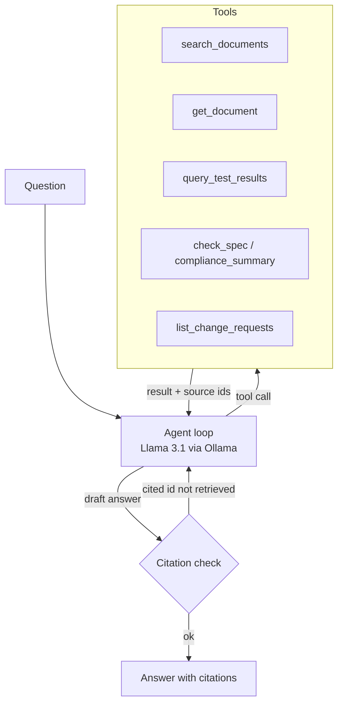

# R&D Knowledge Agent

A tool-calling LLM agent that answers engineering questions from specifications, test reports,
change requests, lessons learned and meeting minutes. It runs fully locally on Llama 3.1 through
Ollama, cites a document for every fact, and checks each citation against what its tools actually
returned. An evaluation harness compares it with single-shot RAG on 30 questions.

All product data is fictional: a three-variant built-in oven platform (OV-600B, OV-600P, OV-600S)
with 17 documents, 28 measurements and 23 specification limits.

## Why

Engineers in R&D spend a large part of their time finding things: the latest result of a test,
whether a change request fixed a problem, what was decided in the last review. That information
sits in two shapes. Reports and minutes are text; measurements and limits are tables. Plain RAG
handles the first and is unreliable on the second, because an LLM comparing 7.6 with 7.5 from
retrieved text gets the number or the direction of the limit wrong often enough to matter.

This agent gives the model tools for both shapes and leaves the arithmetic to code.

| Question | Tool the agent should use |
| --- | --- |
| "Does the OV-600P meet the fan noise requirement?" | `check_spec`: latest value against the limit, PASS/FAIL, margin, history |
| "Which OV-600S requirements are still not met?" | `compliance_summary`: every limit of one product |
| "What caused the fan noise failure and what fixed it?" | `search_documents`, then `get_document` |
| "Which change requests are still open?" | `list_change_requests` |
| "What fan-forced energy was measured before and after the baffle change?" | `query_test_results` |

## How it works



- **Tools return source ids.** Every tool result carries the ids of the documents it came from.
- **Citations are verified.** The answer's `[TR-2026-047]`-style citations are parsed and compared
  with the ids the tools returned in this run. A citation to a document that was never retrieved,
  or one that does not exist, triggers one repair round. The UI shows the result.
- **Refusal is a valid answer.** The prompt requires the phrase "not found in the R&D knowledge
  base" when the tools return nothing. Four of the 30 evaluation questions test this.
- **Errors go back to the model.** Unknown products, parameters or ids return a message listing
  the valid values, so the model can correct its call.
- **Bounded loop.** At most six tool calls. Past that the model must answer with what it has.
- **Robust to local models.** If a model writes its tool call as JSON text instead of using the
  tool-calling field, the client recovers it.

Search is BM25 over document sections, with tokenisation that keeps identifiers such as
`OV-600P`, `TR-2026-040` and `0.85` intact. It needs no embedding model and makes exact ids easy to
find. Swapping in embeddings is a contained change in `retrieval.py`.

## Evaluation

`eval/questions.yaml` holds 30 questions in six categories: lookup, measurement, compliance,
change requests, multi-hop and unanswerable. Each question lists the facts the answer must contain,
the documents it must cite and the tools an expert would use.

**Tool layer (no model, runs in CI).** The expert tool calls for each question are executed and
their output is checked for the required facts and sources. This guards the consistency of data,
tools and evaluation set.

| Metric | Result |
| --- | --- |
| Questions fully answerable from tool output | 30 / 30 |
| Required facts present in tool output | 100% |
| Required sources returned by tools | 100% |
| BM25 recall@5 of required sources, raw question, no tools | 82% |

The last line is the motivation for the agent: a single retrieval on the raw question misses
about one in five required documents.

**Agent against baseline (needs Ollama).** `make eval` runs every question through single-shot
RAG and through the agent and writes `reports/eval_baseline_agent.md` with answer accuracy, fact
recall, citation recall and precision, correct refusals, tool selection accuracy and latency,
overall and per category.

<!-- Paste the summary table from reports/eval_baseline_agent.md here after running make eval. -->

## Quickstart

```bash
# 1. Model
ollama pull llama3.1          # any Ollama model with tool calling works, e.g. qwen2.5:7b

# 2. Install and test (the core needs only PyYAML)
python -m pip install -e . pytest
python -m pytest -q

# 3. Use it
python -m rdagent.cli "Which OV-600S requirements are still not met?"

# 4. Evaluate
python -m rdagent.evaluate --mode tools                       # no model needed
python -m rdagent.evaluate --mode compare --model llama3.1    # agent vs baseline
```

The core is pure Python (standard library plus PyYAML), so it runs on locked-down machines where
compiled packages are blocked. The optional web UI needs Streamlit, which does use compiled
packages:

```bash
python -m pip install -e ".[app]"
python -m streamlit run app/streamlit_app.py
```

With Docker: `docker compose up`, then `docker compose exec ollama ollama pull llama3.1` once, and
open http://localhost:8501.

## Project layout

```
data/documents/      17 Markdown documents with YAML front matter
data/test_results.csv  28 measurements, each linked to its test report
data/spec_limits.csv   23 limits, each linked to a specification section
eval/questions.yaml  30 evaluation questions
src/rdagent/
  corpus.py          loading and section chunking
  retrieval.py       BM25 index
  tools.py           the six tools, argument validation, JSON schemas
  llm.py             Ollama client and a scripted client for tests
  agent.py           agent loop, citation check, single-shot RAG baseline
  evaluate.py        metrics and reports
  cli.py             terminal interface
app/streamlit_app.py chat UI with tool trace and cited documents
tests/               28 tests, including a round trip through a fake Ollama server
```

## Limitations

- The data is synthetic and small. Real R&D archives need access control, document versioning
  and parsers for PDF and Office files.
- BM25 misses paraphrases. The agent compensates with several searches; embeddings or hybrid
  search would help on a larger corpus.
- Fact matching in the evaluation is string-based, so a correct answer phrased differently can be
  scored as wrong. The per-question report shows each answer for manual review.

## License

MIT
